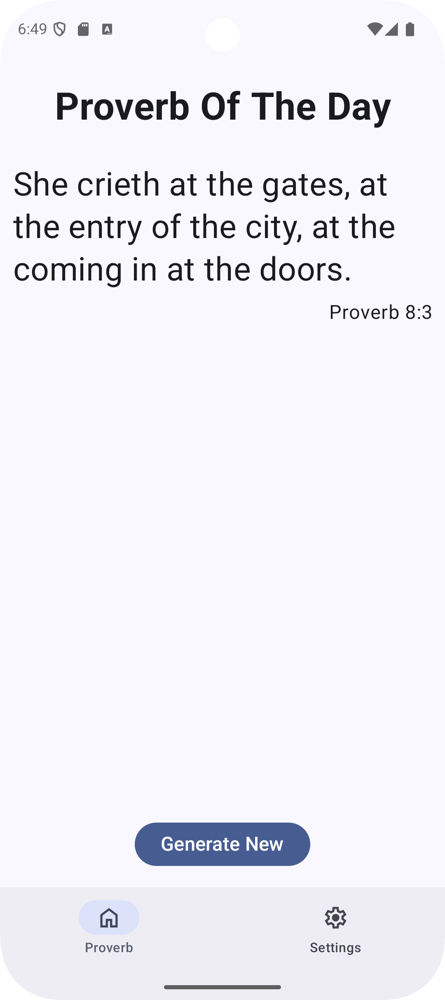

# ProverbOTD

_Proverb Of The Day: Offers a daily proverb from the KJV Bible_

## Features:
**Want a daily dose of wisdom?** This app offers proverbs from the KJV Bible, refreshed every day for new insights each day. The Bible proverbs have remained remarkably relevant even in today's age and hopefully, it will inspire you too!

Features:
- Proverbs generated using a timestamp seed that changes daily
- Notifications available for daily reminders, or to read without opening the app

## Screenshots:

